<p align="center">
  <picture>
    <source media="(prefers-color-scheme: dark)" srcset="apps/web/public/brand/dockfin-logo.png">
    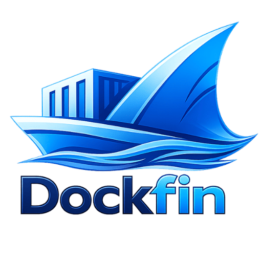
  </picture>
</p>

<h1 align="center">Dockfin</h1>

<p align="center">
  <strong>Deploy apps on your own servers.</strong><br />
  A self-hosted control plane for Docker over SSH — dashboard, API, and CLI in one place.
</p>

<p align="center">
  <a href="LICENSE"></a>
  <a href="VERSION.md"></a>
  
  
  
  <a href="https://github.com/foisalislambd/dockfin/actions/workflows/ci.yml"></a>
</p>

<p align="center">
  Website: <a href="https://dockfin.foisal.org">dockfin.foisal.org</a>
  ·
  Images: <code>ghcr.io/foisalislambd/dockfin</code>
  ·
  <a href="https://hub.docker.com/r/foisalislambd/dockfin">Docker Hub</a>
</p>

---

Dockfin is a central control plane. The browser talks to a Go API; the API keeps desired state in PostgreSQL and runs builds and lifecycle actions on your servers over SSH. There is no long-lived deploy agent on the target machine. One production image serves both the API and the dashboard.

<p align="center">
  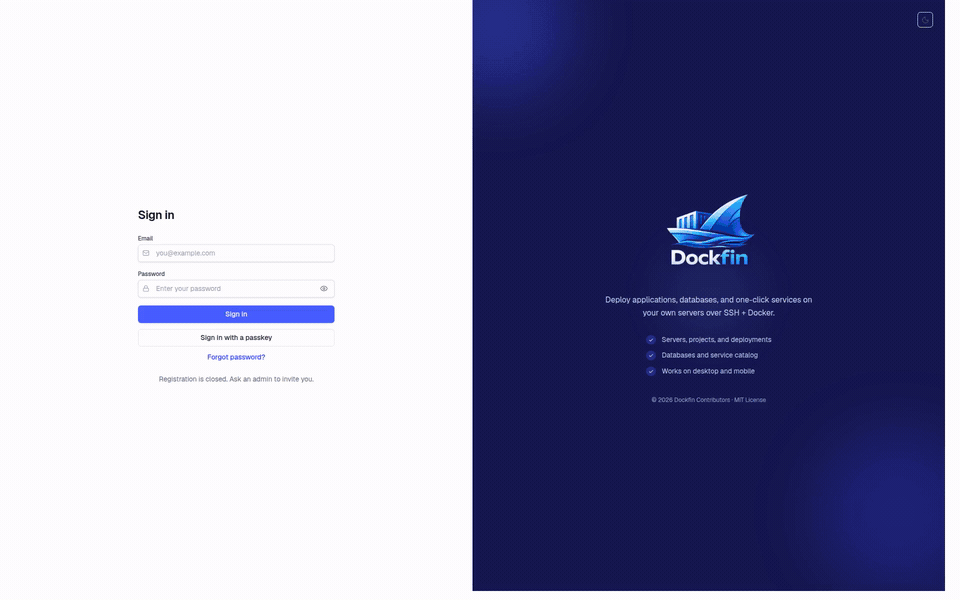
</p>

<p align="center">
  <a href="docs/screenshots/demo.mp4">Watch the MP4</a> (about 41 seconds)
</p>

The clip is a local dashboard: sign in, the fleet pulse, a project with an application, database, and service, a server, and the one-click catalog filtered to Grafana. The host in that session was registered but not reachable, so resources stay in the default `exited` state until a deploy can reach Docker.

## Features

- **Accounts and teams.** Register, session cookies, bearer tokens, TOTP two-factor authentication, passkeys, invitations, and API tokens with abilities.
- **Servers over SSH.** Hosts, Docker destinations, Traefik or Caddy as the proxy, and a browser terminal.
- **Projects and environments.** Group applications, databases, and services. Freeze an environment when deploys should wait.
- **Applications.** Build packs are Dockerfile, Compose, a registry image, Railpack, or static files. Deploys queue, stream logs over SSE, and can roll back.
- **Databases.** PostgreSQL, MySQL, MariaDB, MongoDB, Redis, KeyDB, Dragonfly, ClickHouse, and SQLite, with backups and a configuration UI.
- **One-click services.** 436 Compose templates in [`templates/compose`](templates/compose), Coolify-style metadata (`# name:`, `# port:`, `# logo:`), with magic env keys such as `SERVICE_URL_*` filled in at deploy time.
- **Git and secrets.** Webhooks (GitHub, GitLab, Gitea, Bitbucket), per-resource env vars, and optional Doppler, Infisical, or Vault references resolved only at deploy.
- **Operations.** Audit log, notifications, scheduled tasks, Prometheus metrics, OpenAPI, and the `dfin` CLI.

The full checklist is in [docs/FEATURES.md](docs/FEATURES.md). Design notes are in [docs/ARCHITECTURE.md](docs/ARCHITECTURE.md).

## Screenshots

Sign in, then the first account’s dashboard. Registration locks after that first user until an admin turns it back on.

<p align="center">
  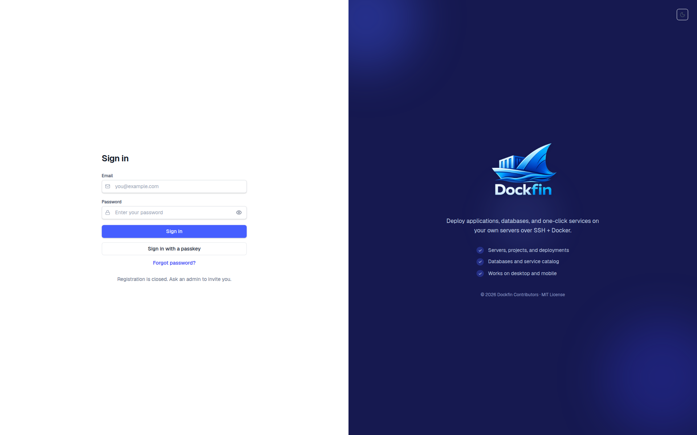
</p>

<p align="center">
  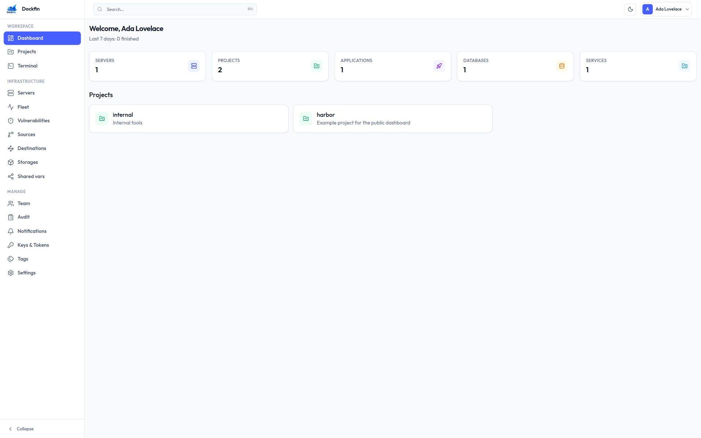
</p>

Projects are the unit you deploy into. Each one starts with a production environment.

<p align="center">
  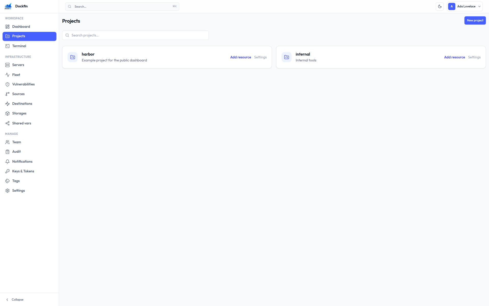
</p>

A project environment lists the application, database, and service that belong to it.

<p align="center">
  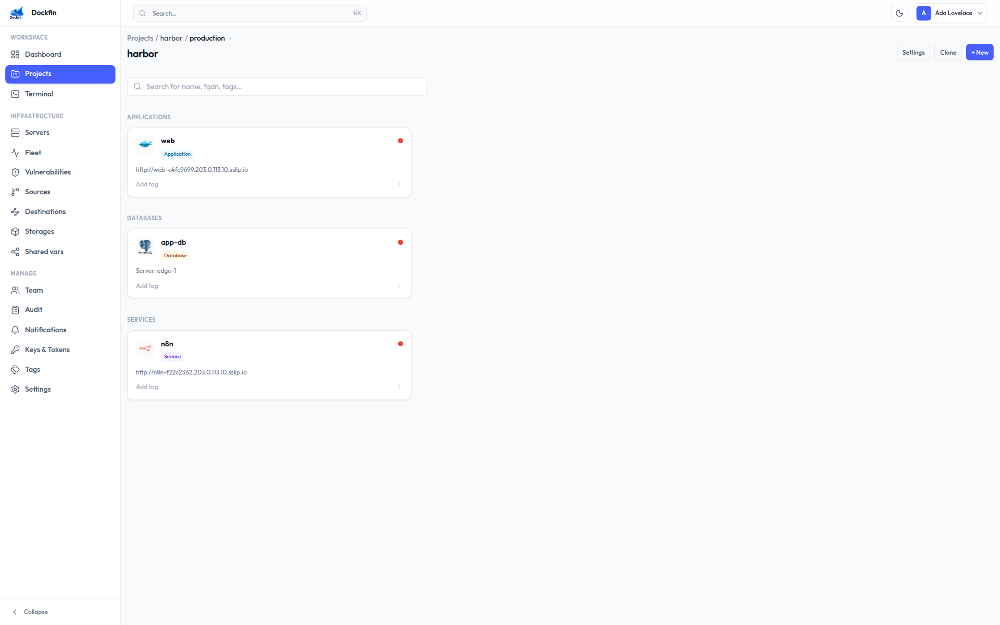
</p>

Application detail covers domains, Git source, deploy, logs, terminal, and backups. This one has not been deployed yet.

<p align="center">
  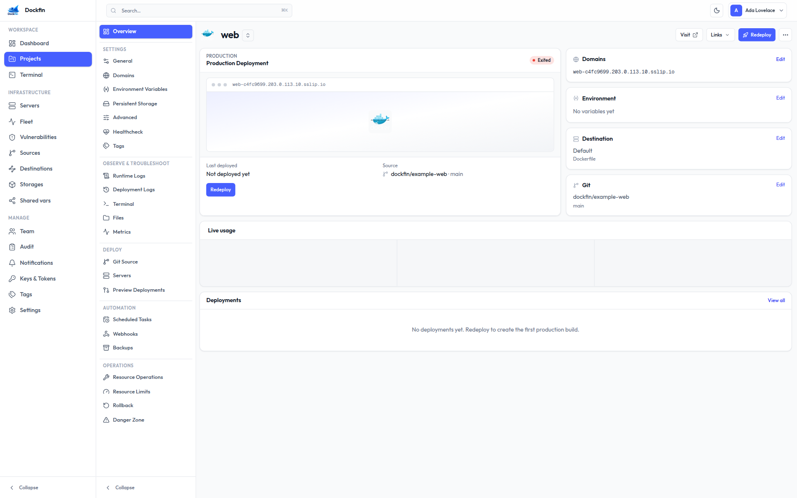
</p>

Database configuration shows the engine and image, public port, TLS, and storage. The same page has tabs for backups, logs, a terminal, files, and metrics.

<p align="center">
  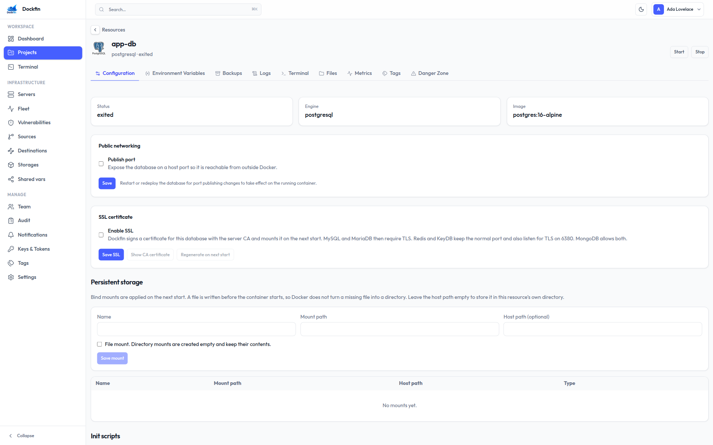
</p>

Servers are SSH targets. Proxy type is Traefik, Caddy, or none.

<p align="center">
  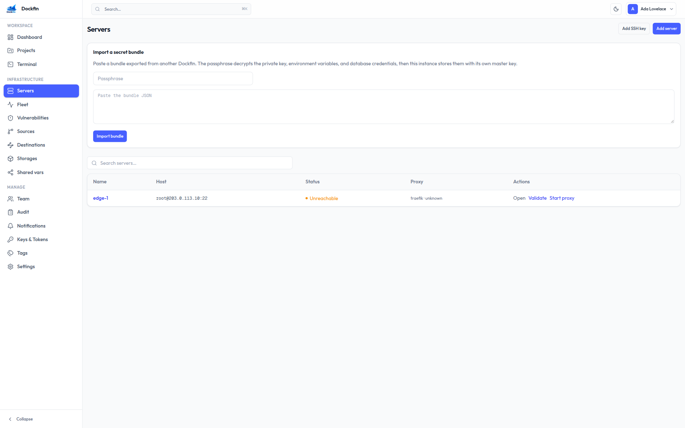
</p>

New services pick from the Compose catalog. The page reports how many templates are loaded.

<p align="center">
  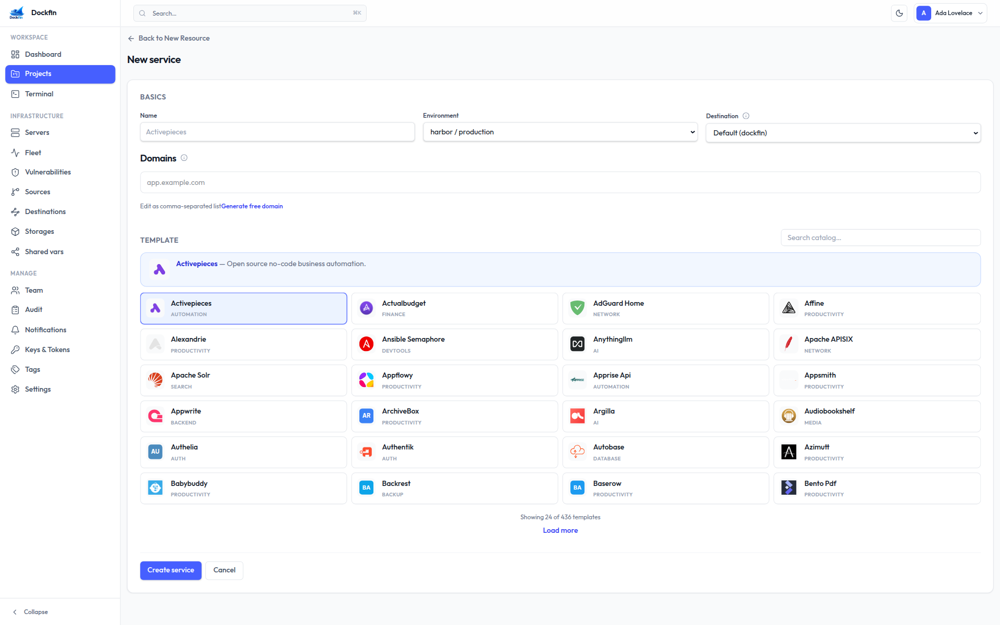
</p>

A service created from a template keeps the prepared Compose units, domains, and environment variables.

<p align="center">
  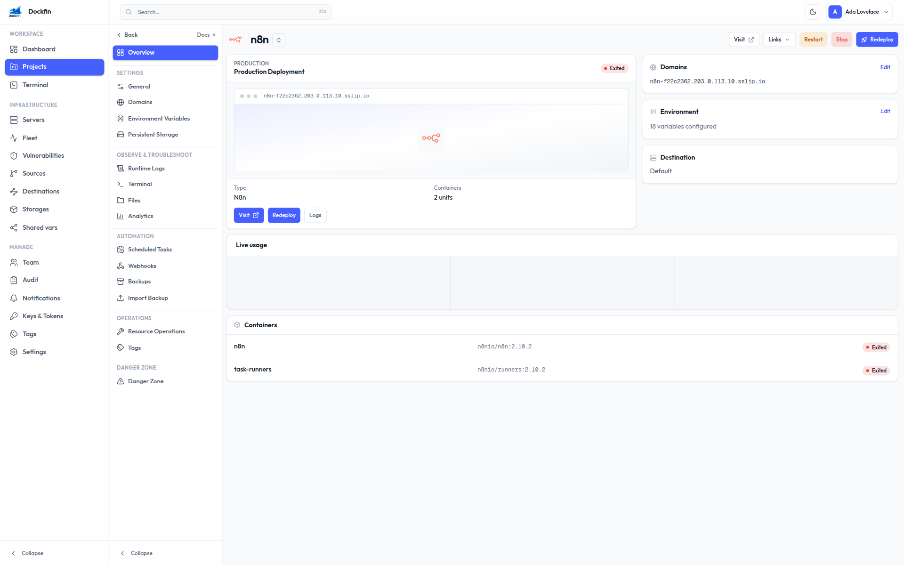
</p>

Instance settings live under Settings: public URL, proxy images, backups, email, OAuth, and scheduled jobs.

<p align="center">
  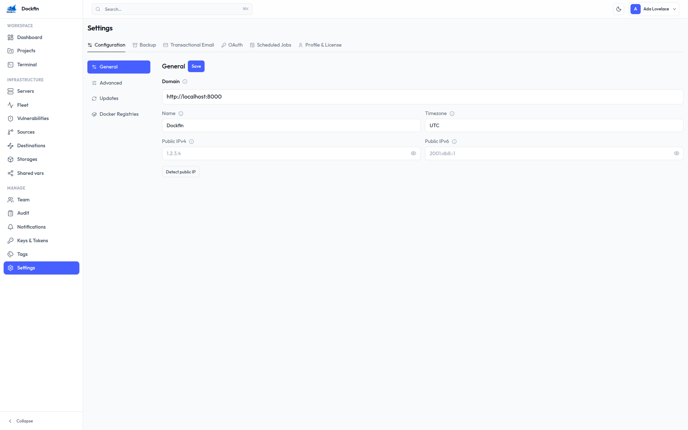
</p>

## Tech stack

| Layer | What it is |
| --- | --- |
| API | Go 1.26, [chi](https://github.com/go-chi/chi), pgx, Goose migrations |
| Data | PostgreSQL. Secrets use AES-256-GCM with `DOCKFIN_MASTER_KEY`. Passwords use argon2id. |
| Dashboard | React 19, Vite, TypeScript, TanStack Router and Query, Tailwind CSS 4 |
| Terminal | xterm.js in the browser, SSH from the API |
| Deploy | In-process queue. Workers SSH to the target and talk to Docker, Traefik, or Caddy. |
| CLI | `dfin` (`cmd/dfin`) calls the same HTTP API |
| Metrics agent | `dockfin-sentinel` (`cmd/dockfin-sentinel`) |

## Getting started

### Production server

A Ubuntu or Debian VPS with a public IP is enough. The script installs Docker if it is missing, writes `/data/dockfin`, pulls the image, and listens on port **8000** so 80 and 443 stay free for the proxy.

```bash
curl -fsSL https://raw.githubusercontent.com/foisalislambd/dockfin/main/scripts/install.sh | sudo bash
```

Open `http://YOUR_SERVER_IP:8000/`, register the first admin, then create a project. The install registers that VPS as a server when `DOCKFIN_BOOTSTRAP_SELF` is on (the default).

Pin a release:

```bash
sudo DOCKFIN_VERSION=2.1.0 \
  bash -c 'curl -fsSL https://raw.githubusercontent.com/foisalislambd/dockfin/main/scripts/install.sh | bash'
```

Update an existing install:

```bash
cd /data/dockfin && sudo docker compose pull && sudo docker compose up -d
```

| Registry | Image |
| --- | --- |
| GitHub Container Registry (what `install.sh` pulls) | `ghcr.io/foisalislambd/dockfin:latest` |
| Docker Hub | `foisalislambd/dockfin:latest` |

### Local development

Prerequisites: **Go 1.26+**, **Node.js 22+**, and **Docker** (for Postgres and Redis, and for deploying containers).

```bash
git clone https://github.com/foisalislambd/dockfin.git
cd dockfin
cp .env.example .env
# Set DOCKFIN_MASTER_KEY to at least 32 characters.

docker compose -f deploy/compose/docker-compose.dev.yml up -d
docker compose -f deploy/compose/docker-compose.dev.yml exec -T postgres pg_isready -U dockfin

set -a && source .env && set +a
go run ./cmd/dockfin migrate
go run ./cmd/dockfin serve
```

The API listens on `http://127.0.0.1:8000` (`/health`, `/api/v1/version`). In another terminal:

```bash
cd apps/web
npm install
npm run dev
```

The Vite dev server is `http://localhost:5173`. `DOCKFIN_CORS_ORIGINS` must include that origin. API changes need a restart of `go run`; UI changes do not.

`make migrate` and `make api` run the same Go commands. `make web` starts Vite.

To serve the built SPA from the API instead of Vite, set `DOCKFIN_WEB_DIR` to `apps/web/dist` after `npm run build`.

### Build the dev image

`scripts/install-dev.sh` builds `dockfin:local` and starts it under `/data/dockfin` on port 8000, same layout as production, without pulling the registry image. Do not run that stack and `go run ./cmd/dockfin serve` at the same time — both want port 8000.

```bash
sudo bash scripts/install-dev.sh
```

### Build binaries

```bash
go build -o bin/dockfin ./cmd/dockfin
go build -o bin/dfin ./cmd/dfin
go build -o bin/dockfin-sentinel ./cmd/dockfin-sentinel
cd apps/web && npm run build
```

## Configuration

Copy [`.env.example`](.env.example). Do not commit `.env`. Service public domains belong on the project (`SERVICE_URL_*` / `SERVICE_FQDN_*`), not in this file.

| Variable | Purpose |
| --- | --- |
| `DOCKFIN_ENV` | `development` or `production` |
| `DOCKFIN_HTTP_ADDR` | Bind address. Default `:8000` |
| `DOCKFIN_DATABASE_URL` | Postgres DSN |
| `DOCKFIN_MASTER_KEY` | At least 32 characters. Encrypts secrets at rest. |
| `DOCKFIN_PUBLIC_URL` | Panel URL used for cookies and links |
| `DOCKFIN_PUBLIC_IP` | Optional address for magic DNS (`*.IP.sslip.io`) |
| `DOCKFIN_DATA_DIR` | Local control-plane data. Default `./data` |
| `DOCKFIN_WEB_DIR` | Built dashboard. Empty while using Vite. |
| `DOCKFIN_TEMPLATES_DIR` | Compose catalog. Default `templates/compose` |
| `DOCKFIN_CORS_ORIGINS` | Include `http://localhost:5173` for the dev UI |
| `DOCKFIN_COOKIE_SECURE` | Set `0` when the panel is plain HTTP |
| `DOCKFIN_BOOTSTRAP_SELF` | Register this machine as a server on the first signup |
| `DOCKFIN_TRUST_PROXY` | Honor `X-Forwarded-*` only when `1` |
| `DOCKFIN_RATE_LIMIT_PER_MINUTE` | Per-IP API budget. Default 600. `0` disables it. |
| `DOCKFIN_AUTH_RATE_LIMIT_PER_15M` | Auth attempts per IP. Default 30. |
| `DOCKFIN_WEBHOOK_RATE_LIMIT_PER_MINUTE` | Webhook calls per IP. Default 120. |
| `DOCKFIN_RATE_LIMIT_STORE` | `memory` (default) or `postgres` to share a budget across replicas |
| `DOCKFIN_METRICS_TOKEN` | If set, `GET /metrics` requires `Authorization: Bearer` |
| `DOCKFIN_AUDIT_RETENTION_DAYS` | Audit history to keep. Default 90. `0` keeps rows. |
| `DOCKFIN_TRAEFIK_IMAGE` | Default `traefik:v3.6` |
| `DOCKFIN_CADDY_IMAGE` | Default `lucaslorentz/caddy-docker-proxy:2.9-alpine` |

On a target server, application, database, service, proxy, and backup files are under `/data/dockfin/`. That path is separate from the control plane’s data directory.

## CLI

`dfin` talks to a running API. `DOCKFIN_URL` defaults to `http://localhost:8000`. `DOCKFIN_TOKEN` is a bearer token. `DOCKFIN_TEAM` sends `X-Team-ID`.

```bash
dfin health
dfin --json projects list
dfin apps create --environment <env-uuid> --name web --git https://github.com/org/repo
dfin env set --resource-type application --resource-id <app-uuid> --key PORT --value 8080
dfin deploy <application-uuid>
dfin logs <deployment-uuid> --follow
```

Commands exit 0 on HTTP 2xx/3xx and 1 otherwise. `dfin help` prints the rest, including freeze, maintenance, server health, and fleet commands.

HTTP surface worth knowing:

| URL | What |
| --- | --- |
| `/health` | Liveness and the running version |
| `/api/v1/version` | Name, version, license |
| `/openapi.json` | OpenAPI 3.1 generated from the live router |
| `/api/docs` | HTML index of the same routes |
| `/metrics` | Prometheus text. Labels use the route pattern, not raw URLs. |

## Project structure

| Path | Role |
| --- | --- |
| `cmd/dockfin` | API binary: `serve`, `migrate`, `version` |
| `cmd/dfin` | CLI |
| `cmd/dockfin-sentinel` | Host metrics agent |
| `internal/httpapi` | Chi routes under `/api/v1` |
| `internal/services` | Compose prepare, templates, deploy helpers |
| `internal/deploy` | Deploy pipeline |
| `internal/proxy` | Traefik and Caddy |
| `internal/store` | Postgres access |
| `migrations` | Goose SQL, embedded in the binary |
| `apps/web` | React dashboard |
| `website` | Marketing site (Astro) |
| `templates/compose` | One-click service YAML |
| `deploy/docker/Dockerfile.api` | Production image (API + built UI) |
| `deploy/compose/docker-compose.dev.yml` | Local Postgres and Redis |
| `scripts/install.sh` | Production install from GHCR |
| `scripts/install-dev.sh` | Dev install from a local image |

## Scripts

| Command | What it does |
| --- | --- |
| `make migrate` | `go run ./cmd/dockfin migrate` |
| `make api` | `go run ./cmd/dockfin serve` |
| `make web` | Vite dev server |
| `make test` | `go test ./...` |
| `make build` | API, CLI, and sentinel binaries |
| `scripts/install.sh` | Production install |
| `scripts/install-dev.sh` | Build `dockfin:local` and start it |
| `scripts/e2e-smoke.sh` | Smoke checks against a running API |
| `cd apps/web && npm run build` | Typecheck and production bundle |
| `cd apps/web && npm run lint` | oxlint |

Focused Go tests used while changing the API:

```bash
go test ./internal/services/ ./internal/httpapi/ ./internal/proxy/ -count=1
```

## Releases

The version string is in [VERSION.md](VERSION.md). A push to `main` publishes a GitHub Release and Docker images only when that `X.Y.Z` is higher than the latest `vX.Y.Z` tag. Bump `VERSION.md` in the commit that should be released.

## Contributing

See [CONTRIBUTING.md](CONTRIBUTING.md) and the [Code of Conduct](CODE_OF_CONDUCT.md). Security reports go through [SECURITY.md](SECURITY.md), not the public issue tracker. [CHANGELOG.md](CHANGELOG.md) tracks releases.

## License

[MIT](LICENSE) © 2026 Dockfin Contributors
